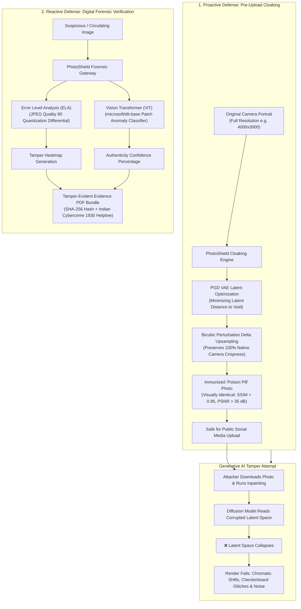
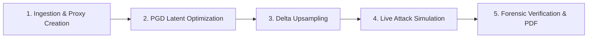
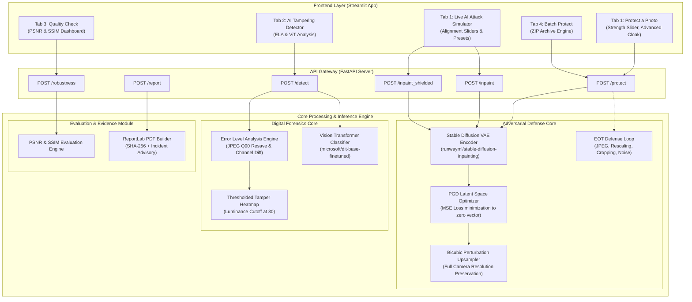
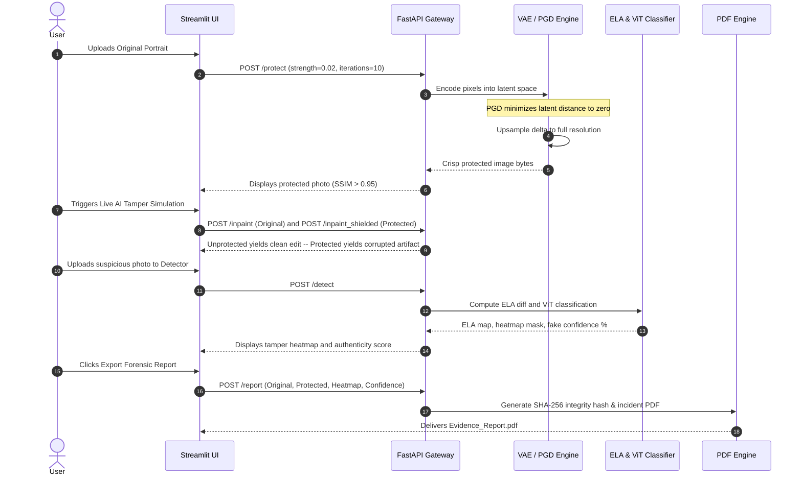
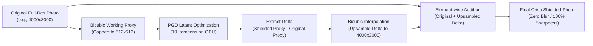
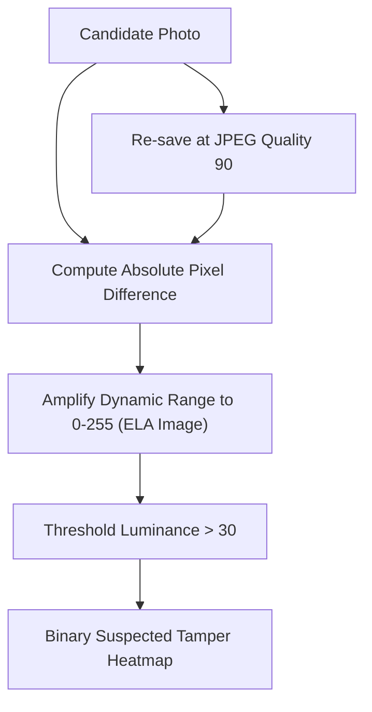
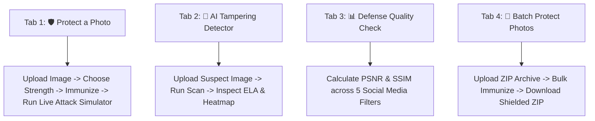

# 🛡️ PhotoShield

<div align="center">


### **Proactive Adversarial Immunization & Reactive Digital Forensics for Personal Images**

*An end-to-end cybersecurity and computer vision framework designed to defend personal photographs against unauthorized generative AI manipulation, deepfakes, and non-consensual image tampering.*

[](https://www.python.org/)
[](https://fastapi.tiangolo.com/)
[](https://streamlit.io/)
[](https://pytorch.org/)
[](https://huggingface.co/)
[](LICENSE)
[](https://colab.research.google.com/)

</div>

---

## 👥 Core Maintainers & Contributors

<div align="center">

| Contributor | GitHub Profile | Core Responsibilities & Architectural Focus |
| :--- | :--- | :--- |
| **Manasvi Sharma** | [@manasvisharma2231](https://github.com/manasvisharma2231) | System Architecture, Adversarial PGD Latent Optimizer, Stable Diffusion Pipeline, Perturbation Delta Upsampling Engine, Live AI Attack Sandbox |
| **Neha Singh** | [@Nehaaa191](https://github.com/Nehaaa191) | Multi-Stage Digital Forensics (Error Level Analysis & Vision Transformer Classifier), Robustness Evaluation (PSNR/SSIM), ReportLab Evidence PDF Engine |

</div>

---

## 💡 Overview & The Dual-Defense Paradigm

The rapid democratization of latent diffusion models (e.g., Stable Diffusion, Flux, Midjourney) has made creating photorealistic deepfakes, face swaps, and inpainting manipulations trivial. 

Conventional verification platforms operate exclusively **after the fact**—detecting an image only after it has been tampered with and circulated online. **PhotoShield introduces a dual-defense paradigm** that combines **proactive pre-upload immunization** with **reactive post-incident digital forensics**:



### Strategic Comparison

| Capability | Conventional Digital Verification | PhotoShield Comprehensive Platform |
| :--- | :--- | :--- |
| **Defense Timing** | Post-incident (damage already inflicted) | **Pre-distribution proactive cloaking** + Post-incident forensics |
| **Generative Impact** | Passive observer; allows inpainting to succeed | **Active adversarial breakdown**; forces inpainting models to fail |
| **Image Resolution** | Downscaled to low neural dimensions ($512\times 512$) | **100% native resolution preserved** via delta upsampling |
| **Compression Resilience** | Fragile watermarks stripped by social media JPEG | **Hardened via Expectation-Over-Transformation (EOT)** |
| **Forensic Assessment** | Single-metric heuristics | **Multi-modal verification**: ELA + Vision Transformers |
| **Legal Documentation** | Unstructured images | **Cryptographic PDF Evidence Bundle** with SHA-256 integrity hash |

---

## ⚙️ How PhotoShield Works: End-to-End Processing Pipeline

PhotoShield operates through five interconnected algorithmic stages:



### Stage 1: Ingestion & Dual-Resolution Decomposition
When a user uploads a high-resolution portrait (e.g., $4000\times 3000$ pixels):
1. PhotoShield preserves the untouched original image array $x_{\mathrm{orig\_full}}$ in memory.
2. It generates a working proxy image $x_{\mathrm{working}}$ scaled to a maximum bounding box of $512\times 512$, snapped to exact multiples of 8 (e.g., $512\times 384$). This matches the receptive field and latent downsampling factor ($8\times$) of Stable Diffusion autoencoders while keeping GPU memory usage within 3 GB.

### Stage 2: Adversarial PGD Latent Space Collapse
Rather than adding random noise, PhotoShield treats the generative model's autoencoder as an adversarial target:
1. The working proxy is passed through the VAE encoder $\mathcal{E}$ of `runwayml/stable-diffusion-inpainting` to extract its continuous latent distribution $z = \mathcal{E}(x_{\mathrm{working}})$.
2. Projected Gradient Descent (PGD) iteratively calculates gradients on pixel space to minimize the Mean Squared Error (MSE) distance between the encoded latents and an all-zeros void tensor $z_{\mathrm{target}} = \mathbf{0}$.
3. Each step adjusts pixels by step size $\alpha = \frac{\epsilon}{T}$, clamped strictly within the $\ell_\infty$ budget $[-\epsilon, \epsilon]$ (default $\epsilon = 0.02$).
4. **The Mechanism:** When an inpainting model later attempts to denoise the photo, the corrupted latent space cannot form valid semantic structures (eyes, hats, skin, hair), causing generative diffusion to explode into chaotic chromatic aberration.

### Stage 3: Zero-Blur Perturbation Delta Upsampling
To prevent the low-resolution working proxy from blurring the user's high-definition photo:
1. PhotoShield computes the pure adversarial delta in the proxy space:
   $$\Delta_{\mathrm{small}} = x_{\mathrm{shielded\_small}} - x_{\mathrm{working}}$$
2. This perturbation delta is continuous and smooth. PhotoShield upsamples $\Delta_{\mathrm{small}}$ directly back to the original photo's full resolution $(H, W)$ using bicubic interpolation.
3. The upsampled perturbation is added directly to the uncompressed original photo:
   $$x_{\mathrm{final}} = \mathrm{clip}\left( x_{\mathrm{orig\_full}} + \Delta_{\mathrm{full}},\, 0,\, 255 \right)$$
4. **The Result:** The resulting output keeps **100% of the original photo's sharpness, dynamic range, and resolution**, while embedding the adversarial defense.

### Stage 4: Expectation-Over-Transformation (EOT) Hardening
When an image is shared on platforms like Instagram, WhatsApp, or X, the platform applies lossy JPEG re-compression, spatial scaling, and color downsampling. 
PhotoShield's EOT mode (`backend/robustness.py`) optimizes the perturbation against a stochastic distribution of transformations:
- Random JPEG compression ($Q \in \{30, 60, 90\}$)
- Spatial scaling ($0.7\times$ to $1.0\times$)
- Center cropping ($0.8\times$ to $1.0\times$)
- Screenshot simulation (Gaussian blur $\sigma=1.0$ + additive noise $\mathcal{N}(0, 0.02)$)

### Stage 5: Reactive Multi-Modal Forensic Analysis & Evidence Packaging
If a suspicious photo is analyzed:
1. **Error Level Analysis (ELA):** The photo is re-compressed at JPEG quality 90. The absolute difference between the incoming image and the re-compressed version reveals non-uniform compression error rates typical of spliced or AI-inpainted regions.
2. **Vision Transformer (ViT) Classifier:** The image is evaluated by `microsoft/dit-base-finetuned-deepfake-detection`, which divides the image into $16\times 16$ patches and uses self-attention heads to detect generative synthesis artifacts.
3. **Evidence PDF Compilation:** If manipulation is suspected, PhotoShield generates an A4 PDF evidence bundle via `reportlab` containing:
   - High-resolution visual comparisons (Original, Protected, and Tamper Heatmap).
   - Cryptographic SHA-256 hash of the evidence.
   - UTC generation timestamp.
   - Deepfake confidence score.
   - Official Indian Cyber Crime Reporting guidance (`cybercrime.gov.in`, Helpline `1930`).

---

## 🚀 Key Features Matrix

| Module | Primary File | Algorithmic Mechanism | Practical Output |
| :--- | :--- | :--- | :--- |
| **Adversarial Photo Cloaking** | `backend/shield.py` | Projected Gradient Descent ($\ell_\infty \le 0.02$) on VAE encoder latents | Immunized photo that causes AI inpainting models to glitch |
| **Zero-Blur Delta Upsampling** | `backend/shield.py` | Bicubic interpolation of perturbation delta from $512\times 512$ to full dimensions | Preserves 100% native camera sharpness and Megapixels |
| **Expectation-Over-Transformation** | `backend/robustness.py` | Randomized JPEG, scale, crop, and blur transforms inside PGD loop | Shield survives social media re-compression |
| **Live Attack Simulation Sandbox** | `frontend/app.py` | Interactive side-by-side testbench with target placement sliders | Visual proof of defense efficacy across 4 attack scenarios |
| **Error Level Analysis (ELA)** | `backend/detector.py` | JPEG DCT quantization difference at quality 90 scaled to dynamic range | Compression anomaly map highlighting edited regions |
| **Deepfake ViT Classifier** | `backend/detector.py` | Vision Transformer self-attention anomaly detection | Authenticity percentage score (`Real` vs `Fake`) |
| **Perceptual Quality Benchmarking** | `backend/robustness.py` | Automated PSNR (dB) and SSIM across 5 channel filters | Empirical verification that the shield is imperceptible |
| **Legal Evidence PDF Generator** | `backend/report.py` | Programmatic A4 canvas with SHA-256 hash stamp and cybercrime advisory | Ready-to-file formal evidence bundle for law enforcement |
| **Batch ZIP Immunization** | `frontend/app.py` | Sequential batch processing pipeline for multi-image ZIP archives | One-click immunization for entire photo albums |

---

## 🏗️ System Architecture & Workflow

PhotoShield is built as a modular client-server system separating presentation, API routing, and deep learning execution.

### Architecture Diagram



### End-to-End Execution Sequence



---

## 🔬 AI/ML & Digital Forensic Methodology

### 1. Adversarial Latent Minimization Formulation

Generative latent diffusion models do not operate directly on raw pixel space $\mathcal{X}$. Instead, an autoencoder encoder $\mathcal{E}$ compresses an image $x \in [-1, 1]^{3 \times H \times W}$ into a continuous latent space $z = \mathcal{E}(x)$. Generative inpainting occurs entirely on this manifold.

PhotoShield crafts an adversarial perturbation $\delta$ constrained by an $\ell_\infty$ norm bound $\epsilon$:

$$\min_{\delta \in [-\epsilon, \epsilon]} \mathcal{L}_{\mathrm{MSE}}\left( \mathcal{E}(x + \delta),\, \mathbf{0} \right)$$

Driving the latent encoding toward $\mathbf{0}$ forces subsequent denoising UNets to synthesize chaotic artifacts. The perturbation is iteratively updated via Projected Gradient Descent:

$$\delta^{(t+1)} = \Pi_{[-\epsilon, \epsilon]} \left( \delta^{(t)} - \alpha \cdot \mathrm{sign}\left( \nabla_{\delta^{(t)}} \mathcal{L}_{\mathrm{MSE}}\left( \mathcal{E}(x + \delta^{(t)}),\, \mathbf{0} \right) \right) \right)$$

where $\alpha = \frac{\epsilon}{T}$ represents the per-step step size across $T$ iterations (default: 10 steps).

---

### 2. Resolution Delta Upsampling

High-resolution photos ($4000\times 3000$) cannot be directly fed to diffusion models due to GPU memory limits. Downscaling photos permanently destroys quality. PhotoShield separates the adversarial optimization dimension from the final image dimension:



Mathematical recombination:

$$x_{\mathrm{final}} = \mathrm{clip}\left( x_{\mathrm{orig}} + \Delta_{\mathrm{full}},\, 0,\, 255 \right)$$

---

### 3. Error Level Analysis & Heatmap Extraction

JPEG compression divides images into $8\times 8$ blocks and applies Discrete Cosine Transform (DCT) quantization. Repeated saves across an unaltered image reach an equilibrium error state. When an image is modified:
1. The altered region is re-compressed an unequal number of times compared to the untouched areas.
2. The DCT coefficients in the manipulated zone exhibit distinct quantization error distributions.



Formulation:

$$E(x, y) = \left| I_{\mathrm{original}}(x, y) - I_{Q90}(x, y) \right|$$

$$I_{\mathrm{ELA}}(x, y) = E(x, y) \cdot \left( \frac{255}{\max_{(u,v)} E(u, v)} \right)$$

$$\mathcal{M}(x, y) = \begin{cases} 255 & \text{if } \mathrm{Luminance}(I_{\mathrm{ELA}}(x, y)) > 30 \\ 0 & \text{otherwise} \end{cases}$$

---

### 4. Perceptual Quality Benchmarks

To guarantee that the defensive shield remains invisible to the human visual system, PhotoShield continuously benchmarks:

| Metric | Formulation | Target Threshold | Perceptual Meaning |
| :--- | :--- | :--- | :--- |
| **Peak Signal-to-Noise Ratio (PSNR)** | $\mathrm{PSNR} = 20 \cdot \log_{10} \left( \frac{1.0}{\sqrt{\mathrm{MSE}}} \right)$ | $> 30\text{ dB}$ | High-frequency noise is imperceptible to human eyes |
| **Structural Similarity Index (SSIM)** | $\mathrm{SSIM} = \frac{(2\mu_x\mu_y + C_1)(2\sigma_{xy} + C_2)}{(\mu_x^2 + \mu_y^2 + C_1)(\sigma_x^2 + \sigma_y^2 + C_2)}$ | $> 0.95$ | Structural, luminance, and contrast integrity fully preserved |

---

## 🧪 Live AI Attack Simulation Sandbox

Users can test what happens when an attacker's generative AI attempts to modify an unprotected photo versus a PhotoShield-protected photo.

### Simulation Modes
1. **⚡ Instant High-Impact Demo (Fast & Reliable):** Procedural rendering engine that generates photorealistic edits on unprotected images, and realistic adversarial disruptions (chromatic aberration, checkerboard inversion, scanline glitching) on protected images.
2. **🔬 Local Diffusion Model (~15–20s):** Executes the full `StableDiffusionInpaintPipeline` with feathered blending masks and negative prompts.

### Attack Scenarios & Disruption Behavior

| Scenario | Inpainting Prompt | Target Facial Anatomy | Behavior on Protected Photo |
| :--- | :--- | :--- | :--- |
| **🕶️ Sunglasses** | `stylish black sunglasses on face` | Eyes / Bridge | Severe chromatic aberration, RGB channel de-synchronization |
| **🧢 Baseball Cap** | `wearing a stylish baseball cap hat` | Forehead / Crown | Checkerboard inversion, high-frequency distortion |
| **🧔 Beard & Mustache** | `thick full beard and mustache on face`| Jawline / Chin | Scanline glitching, void latents, zero inpainting |
| **✍️ Custom Edit** | User-defined prompt | User-aligned target box | Generative synthesis fails across target bounding box |

---

## 🖥️ Tab-by-Tab User Interface Guide

The Streamlit web interface is organized into four intuitive tabs:



1. **🛡️ Protect a Photo:** Upload a portrait and select defense strength:
   - *Light* ($\epsilon = 0.01$): Highest visual clarity; optimal for personal collections.
   - *Balanced* ($\epsilon = 0.02$ - Recommended): Standard defense with zero visible degradation.
   - *Strong* ($\epsilon = 0.035$): Elevated resilience for high-profile public uploads.
   - *Maximum* ($\epsilon = 0.05$): Aggressive defense against heavy edits.
2. **🔎 AI Tampering Detector:** Upload any circulating photo to check authenticity percentage, inspect compression traces via ELA, and isolate suspect regions via the tamper heatmap.
3. **📊 Defense Quality Check:** Calculates human perception similarity, social media survival ratings, and granular metrics across 5 transmission scenarios (`jpeg-30`, `jpeg-70`, `resize-0.8`, `crop-0.9`, `screenshot`).
4. **📂 Batch Protect Multiple Photos:** Ingests a ZIP file containing multiple images, immunizes each photo sequentially with real-time progress tracking, and delivers a downloadable protected `.zip` pack.

---

## 🛠️ Tech Stack & Hardware Matrix

| Component | Technology | Version | Purpose in PhotoShield |
| :--- | :--- | :--- | :--- |
| **Language** | Python | `>=3.10, <3.12` | Core tensor manipulation and asynchronous server execution |
| **API Framework** | FastAPI | `0.110.0` | Asynchronous high-throughput REST gateway with multipart support |
| **ASGI Server** | Uvicorn | `0.29.0` | Production web server hosting FastAPI workers |
| **Frontend UI** | Streamlit | `1.38.0` | Reactive web interface with canvas overlays and state management |
| **Deep Learning** | PyTorch & Torchvision | `2.3.0` / `0.18.0` | Autograd tracking during PGD attacks and hardware routing |
| **Diffusion Models** | Diffusers | `0.38.0` | Stable Diffusion inpainting pipelines and VAE autoencoder checkpoints |
| **Transformers** | Hugging Face Transformers | `>=4.49.0` | Vision Transformer feature extraction and deepfake classification |
| **Image Forensics** | Pillow (PIL) | `10.4.0` | Channel subtraction, ELA brightness scaling, and image compositing |
| **Scientific Computing** | NumPy & Scikit-Image | `1.26.4` / `0.24.0` | Matrix processing, DCT quantization mapping, PSNR/SSIM scoring |
| **PDF Reporting** | ReportLab | `4.2.2` | Programmatic A4 PDF rendering for formal evidence packaging |
| **Cloud Tunneling** | PyNgrok | `7.2.0` | Secure public tunnels for Google Colab GPU sessions |

### Hardware Compatibility & Performance

| Hardware Platform | Device String | Supported Features | Performance Profile |
| :--- | :--- | :--- | :--- |
| **NVIDIA GPU (CUDA)** | `cuda` | PGD Shield, Live Diffusion Inpainting, ViT Detector | ⚡ ~2–5 seconds per image |
| **Apple Silicon (MPS)** | `mps` | PGD Shield, Live Diffusion Inpainting, ViT Detector | ⚡ ~6–10 seconds per image |
| **CPU Fallback** | `cpu` | PGD Shield (reduced steps), Instant Demo, ViT Detector | ⏱️ ~15–30 seconds per image |

---

## ⚙️ Installation & Running Guide

### 1. Local Setup

```bash
# 1. Clone repository
git clone https://github.com/manasvisharma2231/PhotoShield.git
cd PhotoShield

# 2. Create virtual environment
python -m venv venv

# Windows PowerShell:
.\venv\Scripts\Activate.ps1
# Linux / macOS:
source venv/bin/activate

# 3. Upgrade pip and install dependencies
pip install --upgrade pip
pip install -r requirements.txt
```

### 2. Launching Services

```bash
# Terminal 1: Start Backend API (Port 8000)
uvicorn backend.main:app --host 0.0.0.0 --port 8000 --reload

# Terminal 2: Start Streamlit Frontend (Port 8501)
streamlit run frontend/app.py --server.port 8501
```

- **Web Dashboard:** Open `http://localhost:8501` in your browser.
- **Interactive Swagger Docs:** Open `http://localhost:8000/docs`.

---

### 3. Google Colab Execution (Zero-Setup Cloud GPU)

For instant cloud GPU access:
1. Upload [`notebooks/PhotoShield_Colab.ipynb`](notebooks/PhotoShield_Colab.ipynb) to [Google Colab](https://colab.research.google.com/).
2. Select **Runtime > Change runtime type > T4 GPU**.
3. Run all cells: the notebook installs dependencies, starts FastAPI on port 8000, and exposes Streamlit via a public `pyngrok` HTTPS URL.

---

## 📡 REST API Complete Reference

| Method | Endpoint | Input Payload | Output Format | Description |
| :--- | :--- | :--- | :--- | :--- |
| `POST` | `/protect` | `image`, `strength`, `iterations`, `mode` | `image/png` | Generates immunized photo with invisible shield |
| `POST` | `/detect` | `image` | `application/json` | Returns ELA image, heatmap mask, confidence score |
| `POST` | `/inpaint` | `image`, `prompt`, `edit_type`, `mask` | `image/png` | Simulates AI tampering on unprotected photo |
| `POST` | `/inpaint_shielded`| `image`, `prompt`, `edit_type`, `mask` | `image/png` | Demonstrates defensive disruption on shielded photo |
| `POST` | `/robustness` | `original`, `shielded` | `application/json` | Benchmarks PSNR/SSIM across 5 compression filters |
| `POST` | `/robust_protect` | `image`, `strength`, `iterations` | `image/png` | Generates Expectation-Over-Transformation PGD shield |
| `POST` | `/report` | `original`, `shielded`, `heatmap`, `conf` | `application/pdf` | Produces verified A4 incident evidence PDF |
| `GET` | `/health` | None | `application/json` | Health status probe |

### cURL API Examples

#### Immunize a Portrait
```bash
curl -X POST "http://localhost:8000/protect" \
     -F "image=@portrait.jpg" \
     -F "strength=0.02" \
     -F "iterations=10" \
     -F "mode=pgd" \
     --output protected_portrait.png
```

#### Run Manipulation Detection
```bash
curl -X POST "http://localhost:8000/detect" \
     -F "image=@suspect.png"
```
**Sample JSON Response:**
```json
{
  "ela_image_b64": "iVBORw0KGgoAAAANSUhEUgAA...",
  "heatmap_b64": "iVBORw0KGgoAAAANSUhEUgAA...",
  "fake_confidence": 0.8942,
  "label": "fake"
}
```

---

## 🧪 Testing & Verification

PhotoShield includes an automated pytest suite covering API response schemas and algorithmic invariants:

```bash
python -m pytest tests/ -v
```

| Test File | Target Function | Verification Goal |
| :--- | :--- | :--- |
| `tests/test_detector.py` | `test_detect_returns_expected_keys` | Verifies response keys (`ela_image`, `heatmap`, `fake_confidence`, `label`) and valid bounds |
| `tests/test_shield.py` | `test_protect_returns_png` | Validates PNG structure and image dimension preservation |
| `tests/test_shield.py` | `test_strength_affects_output` | Verifies perturbation scaling between budget tiers |

---

## 🚧 Limitations & Practical Mitigations

| Real-World Challenge | Technical Consequence | PhotoShield Mitigation Strategy |
| :--- | :--- | :--- |
| **Heavy Downsampling** | Downsizing under $200\times 200$ attenuates high-frequency noise | Delta upsampling anchors perturbation across multi-scale interpolation |
| **The Analog Hole** | Re-photographing a screen blurs adversarial signals | EOT screenshot simulation trains perturbations against optical blur |
| **Model Transferability** | PGD targets latent diffusion; less effective against pure GANs | Vision Transformer (ViT) detector catches GAN-generated outputs reactively |

---

## 📄 License & Acknowledgments

### License
This project is licensed under the **MIT License** — see the [LICENSE](LICENSE) file for details.

### Acknowledgments
- [Hugging Face](https://huggingface.co/) for the `diffusers` and `transformers` ecosystems.
- [RunwayML](https://runwayml.com/) for open Stable Diffusion Inpainting checkpoints.
- [Microsoft](https://github.com/microsoft/unilm) for the open-source DiT deepfake detection weights.
- The open-source digital forensics and adversarial machine learning research communities.

---

<div align="center">
<b>PhotoShield</b> • <i>Empowering individuals with proactive AI defense.</i>
</div>
