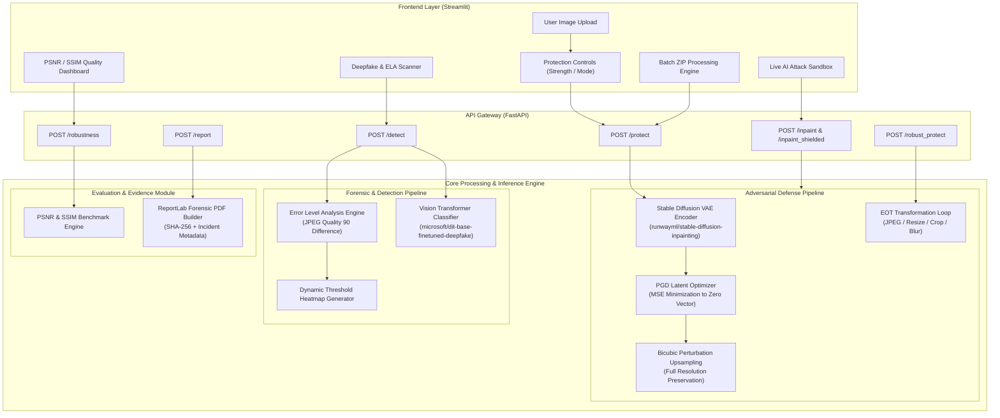
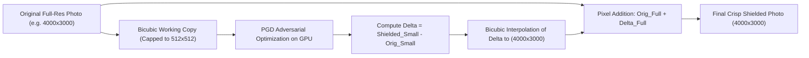

# 🛡️ PhotoShield

<div align="center">


### **Proactive Adversarial Immunization & Reactive Digital Forensics for Personal Images**

*Shielding personal photographs from unauthorized generative AI editing, face swapping, and malicious tampering.*

[](https://www.python.org/)
[](https://fastapi.tiangolo.com/)
[](https://streamlit.io/)
[](https://pytorch.org/)
[](https://huggingface.co/)
[](LICENSE)
[](https://colab.research.google.com/)

[Key Features](#-key-features) • [System Architecture](#-system-architecture) • [Forensic Methodology](#-aiml--forensic-methodology) • [Installation & Setup](#-installation--setup) • [Usage Guide](#-usage-guide) • [API Reference](#-api-reference)

</div>

---

## 📑 Table of Contents

- [Overview](#-overview)
- [Problem Statement](#-problem-statement)
- [Key Features](#-key-features)
- [System Architecture](#-system-architecture)
- [Tech Stack & Tools](#-tech-stack--tools)
- [Project Structure](#-project-structure)
- [Installation & Setup](#-installation--setup)
- [Running PhotoShield](#-running-photoshield)
  - [Local Deployment](#1-local-deployment)
  - [Google Colab Cloud Execution](#2-google-colab-cloud-execution-gpu)
- [Usage Guide](#-usage-guide)
  - [UI Walkthrough](#ui-walkthrough)
  - [Live Attack Simulation](#live-attack-simulation)
- [API Reference](#-api-reference)
- [AI/ML & Forensic Methodology](#-aiml--forensic-methodology)
  - [Adversarial VAE Latent Disruption](#1-adversarial-vae-latent-disruption-pgd)
  - [Expectation-Over-Transformation (EOT)](#2-expectation-over-transformation-eot)
  - [Resolution Preservation via Delta Upsampling](#3-resolution-preservation-via-delta-upsampling)
  - [Error Level Analysis (ELA)](#4-error-level-analysis-ela)
  - [Deepfake Classification with ViT](#5-deepfake-classification-with-vision-transformers)
  - [Image Quality Metrics (PSNR & SSIM)](#6-image-quality-metrics-psnr--ssim)
- [Testing & Quality Assurance](#-testing--quality-assurance)
- [Limitations & Future Scope](#-limitations--future-scope)
- [Contributors](#-contributors)
- [License & Acknowledgments](#-license--acknowledgments)

---

## 💡 Overview

**PhotoShield** is an open-source, dual-layer cybersecurity and digital forensics platform designed to defend individual digital likenesses against unauthorized generative AI manipulation. 

While existing solutions focus exclusively on *post-incident detection* (identifying whether a deepfake has already been manufactured), **PhotoShield introduces a paradigm shift by combining proactive immunization with reactive forensic analysis**:

1. **Proactive Immunization (Pre-Distribution Cloaking):** Injects imperceptible, mathematically bounded adversarial perturbations ($\ell_\infty \le 0.02$) into source photos prior to uploading them to social media. When modern latent diffusion models (e.g., Stable Diffusion, Midjourney, inpainting architectures) attempt to manipulate the photo, their latent representations collapse, outputting severely corrupted, glitched, or blank artifacts.
2. **Reactive Forensic Investigation (Post-Incident Verification):** If a suspected image is found in circulation, PhotoShield employs multi-stage digital forensics—combining classical **Error Level Analysis (ELA)** compression artifact mapping with fine-tuned **Vision Transformer (ViT)** neural classifiers—to calculate authenticity confidence, locate spliced regions via heatmaps, and generate tamper-evident PDF evidence bundles with cryptographic hashes for cybercrime reporting.

---

## ⚠️ Problem Statement

Recent breakthroughs in generative diffusion models, GANs, and automated inpainting frameworks have radically lowered the technical barrier required to produce photorealistic deepfakes, non-consensual image manipulations, face-swaps, and biometric identity theft.

### The Vulnerability of Conventional Verification
- **Passive Detection Fails at Scale:** Forensic detection tools only operate *after* harm has already occurred, by which time malicious media has circulated across digital channels.
- **Social Media Ingestion Recompression:** Platforms recompress images using lossy JPEG/WebP compression, stripping metadata (EXIF/C2PA) and degrading subtle forensic signatures that traditional detectors rely upon.
- **Asymmetric Generative Power:** Anyone with consumer-grade hardware or an API endpoint can alter unimmunized portraits in seconds.

### The PhotoShield Intervention
PhotoShield delivers an accessible, accessible-to-all system that turns personal photos into **generative "poison pills"**: imperceptible to the human visual system (SSIM > 0.95, PSNR > 35 dB), yet mathematically disruptive to neural generative synthesis engines.

---

## 🚀 Key Features

| Capability | Module | Description |
| :--- | :--- | :--- |
| **Adversarial Photo Immunization** | `backend/shield.py` | Projected Gradient Descent (PGD) against diffusion VAE encoder latents, forcing generative inpainting edits to collapse into heavy chromatic artifacts. |
| **Zero-Blur Delta Upsampling** | `backend/shield.py` | Executes adversarial iteration at optimal neural resolution ($512\times 512$) and upsamples the perturbation delta back to full camera resolution using bicubic interpolation, eliminating downsampling artifacts. |
| **Expectation-Over-Transformation (EOT)** | `backend/robustness.py` | Trains defensive perturbation patterns against randomized transforms (JPEG compression, rescaling, cropping, screenshot blurring) to survive social media re-encoding. |
| **Interactive Attack Simulation Sandbox** | `frontend/app.py` | Side-by-side testbench contrasting unprotected image edits vs. immunized image defenses with alignment sliders (sunglasses, hat, beard, custom prompt). |
| **Error Level Analysis (ELA)** | `backend/detector.py` | Computes JPEG quantization differential analysis to expose spliced boundaries, localized compression anomalies, and generative touch-ups. |
| **Deepfake Neural Classifier** | `backend/detector.py` | Evaluates suspicious images against `microsoft/dit-base-finetuned-deepfake-detection` to return authenticity confidence percentages. |
| **Visual Quality Benchmarking** | `backend/robustness.py` | Calculates real-time **PSNR (dB)** and **SSIM** scores across 5 social media transmission filters (`jpeg-30`, `jpeg-70`, `resize-0.8`, `crop-0.9`, `screenshot`). |
| **Legal Evidence PDF Generator** | `backend/report.py` | Produces an A4 forensic incident report with cryptographic SHA-256 image hashes, timestamps, heatmaps, and official Indian cybercrime reporting protocols (`cybercrime.gov.in`, Helpline `1930`). |
| **Batch Archive Protection** | `frontend/app.py` | Ingests ZIP archives, batch immunizes hundreds of images sequentially with progress tracking, and delivers an immunized ZIP download. |

---

## 🏗️ System Architecture

PhotoShield operates on a decoupled client-server architecture. The frontend is driven by **Streamlit** for interactive visualization, interfacing with an asynchronous **FastAPI** backend that manages PyTorch and Hugging Face pipelines with lazy loading and LRU model caching.

### Architecture Diagram



### End-to-End Operational Workflow

```mermaid
sequenceDiagram
    autonumber
    actor User
    participant UI as Streamlit UI
    participant API as FastAPI Backend
    participant VAE as Stable Diffusion VAE
    participant Detector as ELA & ViT Classifier
    participant Report as PDF Engine

    User->>UI: Uploads Original Portrait (PNG/JPG)
    UI->>API: POST /protect (strength=0.02, iterations=10)
    API->>VAE: Forward pass pixel tensor through VAE encoder
    Note over API,VAE: Run PGD loop: perturb pixels to collapse latent representation
    API->>API: Bicubic upsampling of adversarial delta to original dimensions
    API-->>UI: Returns crisp immunized image (PNG)
    
    User->>UI: Simulates attack in Live AI Sandbox
    UI->>API: POST /inpaint (Original) vs POST /inpaint_shielded (Immunized)
    API-->>UI: Unprotected yields clean edit; Protected yields corrupted artifact
    
    User->>UI: Requests Forensic Inspection on suspicious photo
    UI->>API: POST /detect (Image bytes)
    API->>Detector: Run ELA difference & ViT classifier inference
    Detector-->>API: ELA bytes, binary mask heatmap, fake confidence %
    API-->>UI: Displays visual forensic breakdown
    
    User->>UI: Export Evidence Bundle
    UI->>API: POST /report (Original, Shielded, Heatmap, Confidence)
    API->>Report: Generate cryptographic SHA-256 stamp & PDF
    Report-->>UI: Downloads Evidence_Report.pdf
```

---

## 🛠️ Tech Stack & Tools

| Category | Technology / Library | Version | Purpose & Rationale |
| :--- | :--- | :--- | :--- |
| **Core Language** | Python | `>=3.10, <3.12` | Standard environment for PyTorch tensor manipulation and CV pipelines. |
| **Backend API** | FastAPI | `0.110.0` | Asynchronous high-throughput ASGI framework for multi-part file uploads and streaming image responses. |
| **ASGI Server** | Uvicorn | `0.29.0` | Production ASGI web server for concurrent inference routing. |
| **Frontend UI** | Streamlit | `1.38.0` | Interactive web dashboard with reactive tabs, file handling, session state management, and real-time canvas overlays. |
| **Deep Learning** | PyTorch & Torchvision | `2.3.0` / `0.18.0` | Low-level tensor computation, autograd gradient tracking during PGD attacks, and device routing (CUDA/MPS/CPU). |
| **Generative Pipeline** | Hugging Face Diffusers | `0.38.0` | Access to `StableDiffusionInpaintPipeline` and underlying autoencoders for adversarial guidance disruption. |
| **Transformers** | Hugging Face Transformers | `>=4.49.0` | Pipelines for image feature extraction and deepfake classification via Vision Transformers. |
| **Image Forensics** | Pillow (PIL) | `10.4.0` | High-fidelity image manipulation, ELA channel subtraction, brightness scaling, and procedural visual simulation. |
| **Scientific Computing** | NumPy & Scikit-Image | `1.26.4` / `0.24.0` | Matrix processing, DCT quantization mapping, and rigorous calculation of PSNR and SSIM. |
| **Forensic Reporting** | ReportLab | `4.2.2` | Programmatic PDF canvas rendering for legal evidence documentation and A4 formatting. |
| **Tunneling / Colab** | PyNgrok | `7.2.0` | Creates public secure tunnels to host the backend and UI during Google Colab GPU sessions. |

---

## 📁 Project Structure

```text
PhotoShield/
├── .gitignore               # Ignores Python caches, virtual environments, large checkpoints
├── config.yaml              # Global hyperparameters (PGD budget, iterations, image size)
├── requirements.txt         # Pinned production dependencies
│
├── backend/                 # Core FastAPI server and algorithmic processing modules
│   ├── __init__.py          # Package initialization
│   ├── detector.py          # Error Level Analysis (ELA) and Hugging Face deepfake classifier
│   ├── main.py              # FastAPI application exposing all REST endpoints
│   ├── models.py            # Device routing (CUDA/MPS/CPU) and LRU cached model loaders
│   ├── report.py            # PDF evidence bundle generator via ReportLab
│   ├── robustness.py        # PSNR/SSIM benchmarks and Expectation-Over-Transformation (EOT)
│   └── shield.py            # PGD VAE latent attack, delta upsampling, live attack simulator
│
├── frontend/                # Interactive web user interface
│   └── app.py               # Streamlit application (Protect, Detect, Benchmark, Batch)
│
├── notebooks/               # Research, evaluation, and cloud deployment
│   └── PhotoShield_Colab.ipynb # One-click notebook to spin up full GPU stack via ngrok
│
└── tests/                   # Automated unit and integration test suite
    ├── test_detector.py     # Sanity checks for classifier schemas and ELA outputs
    └── test_shield.py       # Validates PNG preservation, sizing, and perturbation bounds
```

### Module Responsibilities

- **`backend/models.py`**: Manages device detection (`cuda`, `mps`, or fallback `cpu`). Uses `@lru_cache(maxsize=1)` to load `runwayml/stable-diffusion-inpainting` (in `fp16` on GPU with attention slicing) and `microsoft/dit-base-finetuned-deepfake-detection` only once across worker lifecycles.
- **`backend/shield.py`**: Implements the core mathematical defense: encodes images to latent distribution space, backpropagates MSE loss against zero-target latents, applies gradient sign clamping, and upsamples perturbation deltas back to original photo dimensions.
- **`backend/detector.py`**: Encapsulates classical image processing (ELA re-quantization at 90% quality) and ViT inference for tamper probability estimation.
- **`backend/robustness.py`**: Benchmarks image survivability against standard social media compression profiles.
- **`backend/report.py`**: Cryptographically hashes shielded outputs (`SHA-256`) and structures visual comparisons with Indian cybercrime reporting advisories.
- **`frontend/app.py`**: Multipage Streamlit dashboard providing intuitive controls, real-time bounding box placement for attack testing, and ZIP batch processing.

---

## ⚙️ Installation & Setup

### Prerequisites
- **Python**: Version `3.10` or `3.11` installed.
- **GPU (Recommended)**: NVIDIA GPU with CUDA 11.8+ or 12.1+ and minimum 6 GB VRAM. (Apple Silicon MPS and CPU are supported via automatic fallback).
- **Git**: Installed and configured.

### Step-by-Step Local Setup

1. **Clone the Repository**
   ```bash
   git clone https://github.com/manasvisharma2231/PhotoShield.git
   cd PhotoShield
   ```

2. **Create and Activate a Virtual Environment**
   - **Linux / macOS**:
     ```bash
     python3 -m venv venv
     source venv/bin/activate
     ```
   - **Windows (PowerShell)**:
     ```powershell
     python -m venv venv
     .\venv\Scripts\Activate.ps1
     ```

3. **Install Dependencies**
   Install PyTorch matching your hardware, then install the pinned requirements:
   ```bash
   pip install --upgrade pip
   pip install -r requirements.txt
   ```

4. **Verify Hardware Acceleration**
   Run the following one-liner to confirm PyTorch detects your hardware:
   ```bash
   python -c "import torch; print('CUDA Available:', torch.cuda.is_available()); print('Device:', torch.cuda.get_device_name(0) if torch.cuda.is_available() else 'CPU/MPS')"
   ```

5. **Configuration (`config.yaml`)**
   Review and adjust default settings in `config.yaml` if needed:
   ```yaml
   strength: 0.02           # ℓ∞ budget for PGD (recommended 0.01 to 0.05)
   iterations: 10           # PGD refinement steps
   mode: pgd                # Defense mode: pgd | diffusion
   image_size: 512          # Working dimension for latent optimization
   cpu_fallback_iters: 5    # Reduced iterations when GPU is absent
   ```

---

## 🏃 Running PhotoShield

### 1. Local Deployment

PhotoShield requires running both the FastAPI backend service and the Streamlit frontend.

#### Terminal 1: Start the Backend Server
From the root directory:
```bash
uvicorn backend.main:app --host 0.0.0.0 --port 8000 --reload
```
The backend initializes the models and starts listening on `http://localhost:8000`. You can explore the interactive OpenAPI documentation at `http://localhost:8000/docs`.

#### Terminal 2: Start the Frontend UI
From the root directory:
```bash
streamlit run frontend/app.py --server.port 8501
```
Open your browser and navigate to **`http://localhost:8501`**.

---

### 2. Google Colab Cloud Execution (GPU)

If you do not have a local NVIDIA GPU, use the pre-configured notebook located at [`notebooks/PhotoShield_Colab.ipynb`](notebooks/PhotoShield_Colab.ipynb):

1. Upload `PhotoShield_Colab.ipynb` to [Google Colab](https://colab.research.google.com/).
2. Navigate to **Runtime > Change runtime type** and select **T4 GPU**.
3. Execute the notebook cells sequentially:
   - Cell 1: Installs required libraries and PyNgrok.
   - Cell 2: Clones the PhotoShield repository.
   - Cell 3: Launches the FastAPI background service on port 8000.
   - Cell 4: Sets up a secure Ngrok tunnel for the backend.
   - Cell 5: Starts Streamlit on port 8501 and returns a public HTTPS URL.
4. Click the generated Ngrok public URL to open the live UI.

---

## 📖 Usage Guide

### UI Walkthrough

The Streamlit interface is divided into four functional tabs:

#### 1. 🛡️ Protect a Photo
- **Step 1:** Upload your portrait (JPG, JPEG, or PNG).
- **Step 2:** Select a Defense Level:
  - *Light* ($\epsilon = 0.01$): Highest visual clarity; optimal for personal collections.
  - *Balanced* ($\epsilon = 0.02$ - Recommended): Standard defense against inpainting with no visible degradation.
  - *Strong* ($\epsilon = 0.035$): Elevated resilience for high-profile public uploads.
  - *Maximum* ($\epsilon = 0.05$): Aggressive defense; introduces subtle high-frequency texture upon close inspection.
- **Step 3:** Click **Immunize Photo Now**. The backend optimizes perturbations and returns your protected image ready for full-resolution download.

#### 2. 🧪 Live AI Attack Simulation
Located directly below the protection section on Tab 1:
- Choose an attack preset: *Sunglasses*, *Baseball Cap*, *Beard / Mustache*, or *Custom Edit*.
- Choose an execution mode:
  - **Instant High-Impact Demo**: Procedural rendering with simulated adversarial latent breakdown (chromatic channel shift, checkerboard inversion, scanline glitching). Recommended for live demonstrations.
  - **Local Diffusion Model**: Runs the actual Stable Diffusion Inpainting pipeline (~15–20 seconds).
- Adjust the **Horizontal**, **Vertical**, and **Coverage Width** sliders to align the red target zone over the subject's face.
- Click **Simulate AI Attack Demo** to compare how the AI alters the unprotected image while failing completely on the immunized image.

#### 3. 🔎 AI Tampering Detector
- Upload any image suspected of being generated, face-swapped, or inpainted.
- Click **Scan for AI Manipulation**.
- Inspect the output:
  - **Authenticity Verdict**: Binary label with confidence score (`Authentic` vs `Likely AI Generated / Manipulated`).
  - **Error Level Analysis (ELA) View**: Highlights digital compression differences where edits occurred.
  - **Tamper Heatmap**: Pinpoints regions exhibiting unnatural high-frequency artifacts.

#### 4. 📊 Defense Quality Check (Robustness)
- With a protected photo loaded, click **Calculate Quality & Similarity Score**.
- View automated perceptual benchmarks:
  - Human Perception Similarity (SSIM percentage).
  - Social media transmission survival ratings.
  - Granular table displaying PSNR (dB) and SSIM across `jpeg-30`, `jpeg-70`, `resize-0.8`, `crop-0.9`, and `screenshot` simulation.

#### 5. 📂 Batch Protect Multiple Photos
- Package multiple JPEG/PNG photos into a single `.zip` archive.
- Upload the file to Tab 4 and click **Protect All Photos in ZIP**.
- Monitor the batch progress bar and download the processed `.zip` bundle containing immunized photos prefixed with `protected_`.

---

## 📡 API Reference

The FastAPI service exposes a complete REST API:

### 1. `POST /protect`
Generates an immunized image using PGD or targeted diffusion mode.

- **Request Type:** `multipart/form-data`
- **Parameters:**
  - `image` *(UploadFile, required)*: Source image binary.
  - `strength` *(float, default: `0.02`)*: Perturbation magnitude ($\epsilon$).
  - `iterations` *(int, default: `10`)*: Optimization gradient steps.
  - `mode` *(string, default: `"pgd"`)*: `"pgd"` or `"diffusion"`.
  - `mask` *(UploadFile, optional)*: Binary mask for targeted mode.
  - `prompt` *(string, optional)*: Expected edit prompt for targeted mode.
- **Response:** Raw binary streaming response (`image/png`).

```bash
curl -X POST "http://localhost:8000/protect" \
     -F "image=@portrait.jpg" \
     -F "strength=0.02" \
     -F "iterations=10" \
     -F "mode=pgd" \
     --output protected_portrait.png
```

---

### 2. `POST /detect`
Performs multi-stage forensic analysis (ELA and ViT classification).

- **Request Type:** `multipart/form-data`
- **Parameters:**
  - `image` *(UploadFile, required)*: Suspect image binary.
- **Response:** `application/json`

```json
{
  "ela_image_b64": "iVBORw0KGgoAAAANSUhEUgAA...",
  "heatmap_b64": "iVBORw0KGgoAAAANSUhEUgAA...",
  "fake_confidence": 0.8942,
  "label": "fake"
}
```

```bash
curl -X POST "http://localhost:8000/detect" \
     -F "image=@suspect.png"
```

---

### 3. `POST /robustness`
Evaluates degradation metrics between the original and shielded images across multiple transformations.

- **Request Type:** `multipart/form-data`
- **Parameters:**
  - `original` *(UploadFile, required)*: Original image binary.
  - `shielded` *(UploadFile, required)*: Shielded image binary.
- **Response:** `application/json`

```json
{
  "results": [
    {"name": "jpeg-30", "psnr": 31.84, "ssim": 0.912},
    {"name": "jpeg-70", "psnr": 36.42, "ssim": 0.968},
    {"name": "resize-0.8", "psnr": 34.12, "ssim": 0.941},
    {"name": "crop-0.9", "psnr": 38.90, "ssim": 0.982},
    {"name": "screenshot", "psnr": 29.75, "ssim": 0.884}
  ]
}
```

---

### 4. `POST /report`
Compiles an evidence bundle into a downloadable A4 PDF.

- **Request Type:** `multipart/form-data`
- **Parameters:**
  - `original` *(UploadFile, required)*: Original image.
  - `shielded` *(UploadFile, required)*: Shielded/manipulated image.
  - `heatmap` *(UploadFile, required)*: Detection heatmap image.
  - `fake_confidence` *(float, required)*: Classifier confidence value.
- **Response:** Binary streaming response (`application/pdf`).

---

### 5. Other Endpoints

| Endpoint | Method | Description |
| :--- | :--- | :--- |
| `/inpaint` | `POST` | Simulates generative tampering on an unprotected image. |
| `/inpaint_shielded`| `POST` | Simulates disruption behavior on an immunized image. |
| `/robust_protect` | `POST` | Applies Expectation-Over-Transformation PGD shielding. |
| `/health` | `GET` | Returns `{"status": "ok"}` for container health probes. |

---

## 🔬 AI/ML & Forensic Methodology

PhotoShield combines deep learning adversarial optimization with classical digital forensics.

```
+---------------------------------------------------------------------------------------------------+
|                                   PHOTOSHIELD DUAL-LAYER PIPELINE                                 |
+-------------------------------------------------+-------------------------------------------------+
|          PROACTIVE DEFENSE (CLOAKING)           |          REACTIVE FORENSICS (DETECTION)         |
+-------------------------------------------------+-------------------------------------------------+
| • Latent Target Minimization (PGD on VAE)       | • Error Level Analysis (JPEG Quantization diff) |
| • Delta Upsampling (Preserves Original Pixels)  | • ViT Image Classifier (microsoft/dit-base)    |
| • Expectation-Over-Transformation (EOT)         | • Legal Evidence PDF Generator (SHA-256 Hash)   |
+-------------------------------------------------+-------------------------------------------------+
```

### 1. Adversarial VAE Latent Disruption (PGD)

Generative latent diffusion models (such as Stable Diffusion) do not operate in high-dimensional pixel space $\mathcal{X}$. Instead, an autoencoder encoder $\mathcal{E}$ compresses an image $x \in [-1, 1]^{3 \times H \times W}$ into a low-dimensional continuous latent space $z = \mathcal{E}(x)$. Generative inpainting occurs entirely within this latent manifold.

PhotoShield creates an adversarial perturbation $\delta$ constrained by an $\ell_\infty$ norm bound $\epsilon$:

$$\min_{\delta \in [-\epsilon, \epsilon]} \mathcal{L}_{\text{MSE}}\left( \mathcal{E}(x + \delta), z_{\text{target}} \right)$$

Where $z_{\text{target}} = \mathbf{0}$. By driving the latent encoding toward a zero vector, any subsequent denoising UNet conditioned on this latent collapses.

The perturbation is iteratively updated via **Projected Gradient Descent (PGD)**:

$$\delta^{(t+1)} = \Pi_{[-\epsilon, \epsilon]} \left( \delta^{(t)} - \alpha \cdot \operatorname{sign}\left( \nabla_{\delta^{(t)}} \mathcal{L}_{\text{MSE}}\left( \mathcal{E}(x + \delta^{(t)}), \mathbf{0} \right) \right) \right)$$

where $\alpha = \frac{\epsilon}{T}$ represents the per-step step size, and $T$ is the total iteration count (default: 10 steps).

<details>
<summary><b>Mathematical Intuition of Latent Breakdown (Click to expand)</b></summary>

Because the VAE encoder features non-linear downsampling layers (strided convolutions and residual blocks), small pixel-level directional shifts aggregate into massive distribution shifts in latent space. When the generative diffusion scheduler introduces Gaussian noise at timestep $t$ and queries the UNet to denoise $\epsilon_\theta(z_t, t)$, the latent features are invalid, causing the decoded image $\mathcal{D}(z_0)$ to explode into extreme chromatic aberration, checkerboard artifacts, and noise.
</details>

---

### 2. Expectation-Over-Transformation (EOT)

Standard adversarial perturbations can be fragile against image transformations (such as social media re-encoding). PhotoShield implements an **Expectation-Over-Transformation (EOT)** pipeline (`backend/robustness.py`), optimizing perturbations across a distribution of stochastic transformation operators $\mathcal{T}$:

$$\min_{\delta} \mathbb{E}_{t \sim \mathcal{T}} \left[ \mathcal{L}\left( \mathcal{E}\left( t(x + \delta) \right), \mathbf{0} \right) \right]$$

The transformation set includes:
- Random JPEG compression ($Q \in \{30, 60, 90\}$)
- Random spatial resizing (scale $\in [0.7, 1.0]$)
- Random central cropping (ratio $\in [0.8, 1.0]$)
- Screenshot simulation (Gaussian blur $\sigma=1.0$ + additive Gaussian noise $\mathcal{N}(0, 0.02)$)

---

### 3. Resolution Preservation via Delta Upsampling

Running PGD directly on high-resolution camera images ($4000\times 3000$ pixels) causes out-of-memory errors on consumer GPUs. Simply resizing the image permanently destroys original photo sharpness.

PhotoShield resolves this with **Perturbation Delta Upsampling**:



1. A working proxy image is downscaled to $512 \times 512$ (aligned to multiples of 8).
2. PGD generates the small adversarial output $x_{\text{shielded\_small}}$.
3. The perturbation delta is isolated: $\Delta_{\text{small}} = x_{\text{shielded\_small}} - x_{\text{orig\_small}}$.
4. $\Delta_{\text{small}}$ is upsampled back to the original full dimensions $(H, W)$ using continuous bicubic interpolation.
5. The upsampled perturbation is added directly to the uncompressed original photo:

$$x_{\text{final}} = \operatorname{clip}\left( x_{\text{orig\_full}} + \Delta_{\text{full}}, 0, 255 \right)$$

This delivers **100% preservation of native camera sharpness** with zero blur.

---

### 4. Error Level Analysis (ELA)

**Error Level Analysis** works on the principle that digital images saved in the lossy JPEG format reach an equilibrium error rate across continuous surfaces. When an image is manipulated:
1. The altered region is re-compressed an unequal number of times compared to the untouched areas.
2. The discrete cosine transform (DCT) coefficients in the manipulated zone exhibit distinct quantization error distributions.

PhotoShield implements ELA by re-saving the candidate image at a fixed quality $Q = 90$:

$$E(x, y) = |I_{\text{original}}(x, y) - I_{Q90}(x, y)|$$

The absolute difference image is scaled by its dynamic range:

$$I_{\text{ELA}}(x, y) = E(x, y) \cdot \left( \frac{255}{\max_{(u,v)} E(u, v)} \right)$$

A localized binary mask is produced by thresholding the luminance channel:

$$\mathcal{M}(x, y) = \begin{cases} 255 & \text{if } \text{Luminance}(I_{\text{ELA}}(x, y)) > 30 \\ 0 & \text{otherwise} \end{cases}$$

---

### 5. Deepfake Classification with Vision Transformers

In addition to heuristic ELA analysis, PhotoShield uses a pre-trained Vision Transformer: [`microsoft/dit-base-finetuned-deepfake-detection`](https://huggingface.co/microsoft/dit-base-finetuned-deepfake-detection).

- The input image is converted to patches ($16\times 16$).
- Self-attention heads analyze structural consistency across spatial patches, identifying synthesis anomalies characteristic of GANs and diffusion decoders.
- The classification head outputs normalized softmax probabilities:

$$P(\text{label}) = \frac{e^{z_{\text{label}}}}{e^{z_{\text{real}}} + e^{z_{\text{fake}}}}$$

---

### 6. Image Quality Metrics (PSNR & SSIM)

To guarantee that the defensive shield remains imperceptible, PhotoShield evaluates:

- **Peak Signal-to-Noise Ratio (PSNR):**
  $$\text{PSNR} = 10 \cdot \log_{10} \left( \frac{\text{MAX}_I^2}{\text{MSE}} \right) = 20 \cdot \log_{10} \left( \frac{1.0}{\sqrt{\frac{1}{3HW} \sum_{c,i,j} (I_1 - I_2)^2}} \right)$$
  *Values above 30 dB indicate near-imperceptible noise to the human visual system.*

- **Structural Similarity Index (SSIM):**
  $$\text{SSIM}(x, y) = \frac{(2\mu_x\mu_y + C_1)(2\sigma_{xy} + C_2)}{(\mu_x^2 + \mu_y^2 + C_1)(\sigma_x^2 + \sigma_y^2 + C_2)}$$
  *Measures luminance, contrast, and structural preservation. PhotoShield targets SSIM $\ge 0.95$.*

---

## 🧪 Testing & Quality Assurance

PhotoShield includes automated unit tests covering core API contracts and algorithmic behavior.

### Running the Test Suite

Execute `pytest` from the root directory:

```bash
python -m pytest tests/ -v
```

### Implemented Test Suites

| File | Tests Included | Purpose |
| :--- | :--- | :--- |
| `tests/test_detector.py` | `test_detect_returns_expected_keys` | Verifies that the detector returns correct dictionary keys (`ela_image`, `heatmap`, `fake_confidence`, `label`), valid float confidence bounds, and binary labels (`real` or `fake`). |
| `tests/test_shield.py` | `test_protect_returns_png`<br>`test_strength_affects_output` | Confirms that immunized outputs maintain valid PNG encoding, match input resolutions, and that increasing $\epsilon$ bounds produces measurable mathematical variances. |

---

## 🚧 Limitations & Future Scope

### Current Limitations
- **Extreme Downsampling:** If a third party downsizes a shielded photo by more than 60% (e.g., to a thumbnail under $200\times 200$), high-frequency adversarial signals may be attenuated.
- **The Analog Hole:** Photographing an immunized screen display with an external physical camera acts as a low-pass optical filter that can degrade adversarial perturbations.
- **Cross-Architecture Transferability:** While VAE-targeted PGD reliably disrupts latent diffusion architectures, purely autoregressive models (e.g., pixel-space transformers) may require alternative perturbation formulations.

### Future Roadmap
- [ ] **C2PA / Content Authenticity Initiative Integration:** Inject cryptographic provenance metadata into immunized photos alongside adversarial perturbations.
- [ ] **Browser Extension:** One-click protection directly in the browser before photos are posted to web platforms.
- [ ] **Client-Side ONNX / WebAssembly Engine:** Run PGD perturbation generation locally in the browser to eliminate server uploads.
- [ ] **Facial Biometric Poisoning:** Integrate feature-space cloaking targeting facial recognition verification networks (e.g., ArcFace, FaceNet).

---

## 👥 Contributors

PhotoShield is maintained by:

- **Manasvi Sharma** ([@manasvisharma2231](https://github.com/manasvisharma2231)) – Architecture, Core Defense Engine, and Live Attack Simulation.
- **Neha Singh** ([@Nehaaa191](https://github.com/Nehaaa191)) – Forensic Detection, ELA Engine, Benchmarks, and Documentation.

Contributions, issues, and feature requests are welcome! Feel free to check the [issues page](https://github.com/manasvisharma2231/PhotoShield/issues).

---

## 📄 License & Acknowledgments

### License
This project is licensed under the **MIT License**. See the [LICENSE](LICENSE) file for details.

### Acknowledgments
- [Hugging Face](https://huggingface.co/) for the `diffusers` and `transformers` ecosystems.
- [RunwayML](https://runwayml.com/) for the open Stable Diffusion Inpainting checkpoints.
- [Microsoft](https://github.com/microsoft/unilm) for the open-source DiT deepfake detection weights.
- The open-source digital forensics and adversarial robustness research communities.

---

<div align="center">
<b>PhotoShield</b> • <i>Proactive defense against unauthorized generative AI manipulation.</i>
</div>

